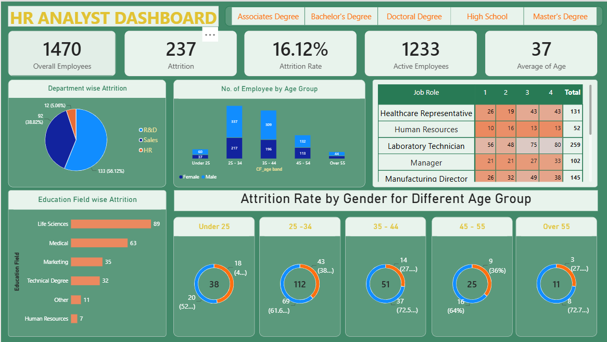

# 📊 HR-ANALYST-DASHBOARD-X-POWER-BI-Projects

An interactive HR Analytics Dashboard developed using Microsoft Power BI to analyze employee data, monitor workforce distribution, evaluate employee attrition, and understand job satisfaction patterns through key performance indicators (KPIs) and data visualizations.

This project demonstrates how Power BI can be used as a Business Intelligence (BI) tool to transform raw HR data into meaningful insights, helping organizations understand workforce trends and make data-driven HR decisions.

---

## 🚀 Project Overview

The objective of this project is to help the HR department monitor and analyze important employee-related metrics.

The dashboard focuses on identifying workforce patterns, understanding employee attrition, analyzing departmental performance, and evaluating employee satisfaction.

It provides insights into:

- Total Employee Count
- Employee Attrition Count
- Employee Attrition Rate
- Active Employee Count
- Average Employee Age
- Gender-wise Attrition Analysis
- Department-wise Attrition Analysis
- Employee Distribution by Age Group
- Job Satisfaction Ratings

---

## 🎯 Problem Statement

The HR department faces challenges in monitoring and analyzing employee data due to a lack of clear performance indicators and visual reporting.

The project addresses the following business problems:

1. **Employee Count:** Lack of visibility into the total workforce size.
2. **Attrition Count:** Difficulty tracking the number of employees leaving the organization.
3. **Attrition Rate:** Lack of a standardized metric to measure employee turnover.
4. **Active Employees:** Difficulty differentiating between active and inactive employees.
5. **Average Age:** Limited visibility into workforce demographics and age distribution.
6. **Gender-wise Attrition:** Difficulty identifying attrition patterns across genders.
7. **Department-wise Attrition:** Lack of visual comparison of attrition across departments.
8. **Age Group Analysis:** Difficulty understanding workforce distribution across different age groups.
9. **Job Satisfaction:** Lack of visual representation of employee satisfaction ratings.

---

## 📂 Dataset

The dataset contains employee information covering workforce demographics, job roles, departments, salary details, job satisfaction, and attrition status.

**Dataset Information:**
- Total Records: 1,470 Employees
- Total Columns: 41
- File Format: Excel (.xlsx)

**Important Dataset Columns:**

- Employee Number
- Age
- Gender
- Department
- Education Field
- Job Role
- Marital Status
- Business Travel
- Attrition
- Monthly Income
- Daily Rate
- Hourly Rate
- Job Satisfaction
- Environment Satisfaction
- Job Involvement
- Relationship Satisfaction
- Work Life Balance
- Total Working Years
- Years At Company
- Years In Current Role
- Years Since Last Promotion
- Years With Current Manager

**Raw Dataset:**

`HR Data.xlsx`

---

## 📈 Dashboard Features

✅ Interactive HR Analytics Dashboard

✅ KPI Cards for Key HR Metrics

✅ Total Employee Count

✅ Employee Attrition Analysis

✅ Attrition Rate Calculation

✅ Active Employee Tracking

✅ Average Employee Age

✅ Gender-wise Attrition Analysis

✅ Department-wise Attrition Analysis

✅ Employee Distribution by Age Groups

✅ Job Satisfaction Analysis

✅ Data Visualization and Business Reporting

---

## 📊 Key Performance Indicators (KPIs)

The dashboard focuses on the following KPIs:

| KPI | Description |
|---|---|
| Employee Count | Total number of employees |
| Attrition Count | Total employees who left |
| Attrition Rate | Percentage of employees who left |
| Active Employees | Number of employees currently retained |
| Average Age | Average age of employees |

---

## 🔍 Key Insights

Based on the analysis of 1,470 employee records:

- **Total Employees:** The organization has 1,470 employees.
- **Employee Attrition:** 237 employees have left the organization.
- **Active Employees:** 1,233 employees remain in the organization.
- **Attrition Rate:** The overall employee attrition rate is 16.12%.
- **Department-wise Attrition:** Sales has the highest departmental attrition rate at approximately 20.63%.
- **Age Group Analysis:** Employees under 25 have the highest attrition rate at approximately 39.18%.
- **Workforce Demographics:** The average employee age is approximately 37 years.

These findings help highlight workforce patterns and areas that may require further HR investigation.

---

## 🛠 Tools & Technologies Used

- Microsoft Power BI
- Microsoft Excel
- Power Query
- Data Cleaning & Transformation
- Data Modeling
- DAX (Data Analysis Expressions)
- KPI Development
- Data Visualization
- Business Intelligence

---

## 🎯 Skills Demonstrated

- Data Cleaning and Preprocessing
- Data Transformation
- Exploratory Data Analysis (EDA)
- Data Modeling
- DAX Calculations
- KPI Development
- Dashboard Development
- Data Visualization
- Business Intelligence
- Analytical Thinking
- Data Storytelling

---

## 📸 Dashboard Preview

**HR Analytics Dashboard:**

**Problem Statement – KPI Requirements:**

.png)
.png)

**Problem Statement – Chart Requirements:**

.png)

**Overview on DataSet – DataSet:**

.png)
.png)

---

## 📌 Learning Outcomes

This project helped me improve my practical understanding of:

- Building interactive dashboards using Power BI.
- Converting business requirements into analytical solutions.
- Creating and analyzing HR performance indicators.
- Using DAX for KPI calculations.
- Transforming raw employee data into meaningful insights.
- Analyzing employee attrition and workforce demographics.
- Designing professional and user-friendly dashboards.
- Communicating business insights through data visualization.

---

## 🤝 Connect With Me

**Karan Veer Pal**

📧 Email: karanpalveer@gmail.com

💼 LinkedIn: https://www.linkedin.com/in/karan-veer-pal/

💻 GitHub: https://github.com/Karan-Veer-Pal

If you find this project useful, feel free to ⭐ star this repository and share your feedback.

Thank you for visiting! 🚀

